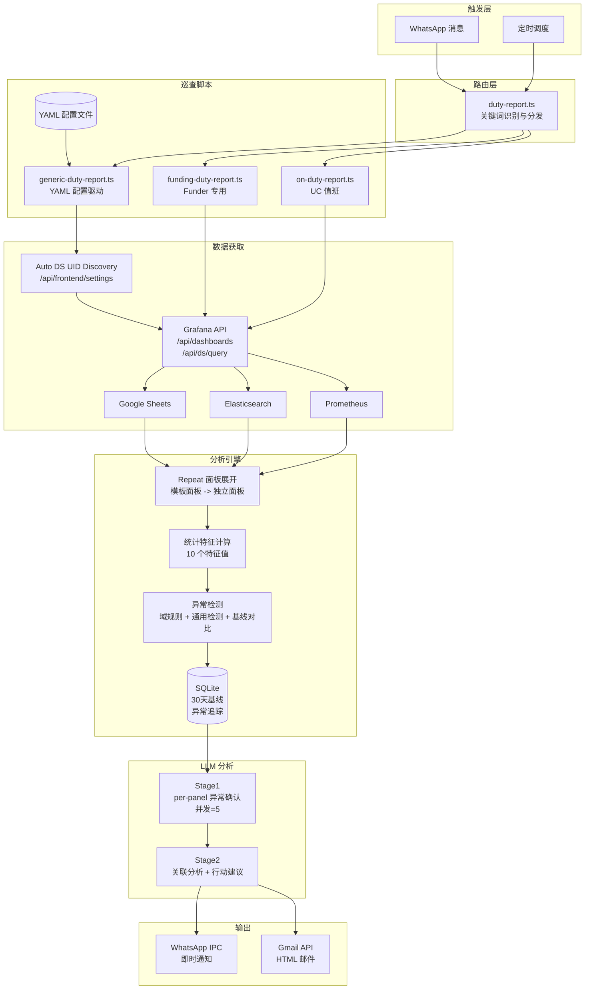
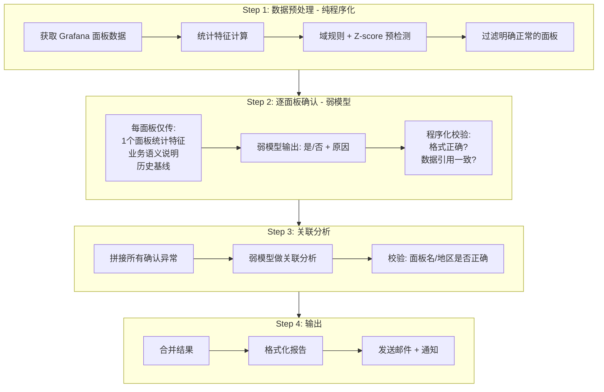

# 值班 Skill 技术分析与推广可行性评估

> 日期: 2026-03-11（最后更新）
> 基于 Funder + Funding Platform 两套值班巡查 Skill 的实际运行数据

---

## 一、系统架构

### 1.1 整体数据流



### 1.2 关键组件

| 组件 | 路径 | 职责 |
|------|------|------|
| 消息路由 | src/commands/duty-report.ts | 识别"值班""funder""platform"等关键词，分发到对应脚本 |
| UC 脚本 | scripts/on-duty-report.ts | UC 激活值班，使用 Go 二进制采集数据 |
| Funder 脚本 | scripts/funding-duty-report.ts | Funder 值班巡查（A大促监控），硬编码逻辑 |
| 通用脚本 | scripts/generic-duty-report.ts | 配置驱动，支持多数据源、多 Dashboard、repeat 面板展开 |
| Funder 配置 | config/duty-dashboards/funding.yaml | A大促监控 Dashboard（Prometheus） |
| Platform 配置 | config/duty-dashboards/funding-platform.yaml | 卡单监控大盘 + 资损类指标（Elasticsearch + Google Sheets） |
| 配置加载 | scripts/lib/duty-config.ts | YAML 解析、规则编译、Prompt 构建、通用检测器 |
| 基线存储 | scripts/lib/duty-metrics-db.ts | SQLite 存储 30 天历史指标，计算均值/标准差基线 |
| DS UID 发现 | scripts/grafana-discover-ds-uids.ts | 通过 API 或 Playwright 发现 ES 数据源 UID 映射 |

### 1.3 YAML 配置详解

YAML 配置文件是通用巡查脚本的核心，包含 7 个区块：

**grafana 区块** -- 数据源连接

```yaml
grafana:
  base_url: "https://monitoring.infra.sz.shopee.io/grafana"
  dashboard_uid: "6SAKQReSk"        # 主 Dashboard UID
  additional_uids:                   # 额外 Dashboard（可选）
    - "ELg2EXqIk"
  org_id: 28
  time_range_hours: 24
  step_minutes: 15
  max_data_points: 96
  datasource_uid_map:                # ES 数据源名称 -> UID 映射（可选，自动发现兜底）
    "Funding-VN-ES": "5xdsNTd4k"
    "Funding-ID-ES": "6f9KfMO4z"
```

**models 区块** -- LLM 模型列表

```yaml
models:
  - "QwQ-32B"       # 第一个模型
  - "compass-max"   # 第二个模型
```

多个模型并行独立运行，各自输出分析结论，最终合并到一封邮件中。

**query 区块** -- 查询性能控制

```yaml
query:
  concurrency: 5        # 并发查询数
  batch_size: 15         # 每批查询的 target 数量
  max_series_per_panel: 10  # 每面板最多保留的序列数
  max_report_chars: 10000   # 报告文本上限
```

**anomaly_rules 区块** -- 域规则（详见 1.4 节）

**generic_detection 区块** -- 通用检测参数（详见 1.5 节）

**output 区块** -- 输出配置

```yaml
output:
  recipient_env: "FUNDING_PLATFORM_DUTY_RECIPIENT"
  fallback_recipient: "huanyu.guo@shopee.com"
  subject_template: "[值班巡查] {today} {name}{critical_tag}"
  ipc_chat_jid: "8619860743536@s.whatsapp.net"
```

**prompt 区块** -- LLM 角色和 Few-shot 示例

```yaml
prompt:
  role: "金融科技 Funding Platform 值班数据分析师"
  dashboard_description: "卡单监控大盘 + 资损类指标"
  stage1_example: |
    VN-内部还款卡单 | 严重 | 内部还款卡单3笔超3小时未处理
  stage2_example: |
    [总体风险] 中
    [一句话总结] VN内部还款卡单需紧急处理
```

### 1.4 域规则（Domain Rules）

域规则通过正则匹配面板标题，对命中的面板应用特定阈值判断。每条规则定义：匹配模式、检测字段、warning/critical 阈值。

当前两套配置的域规则：

**Funder（funding.yaml）-- 7 条规则**

| 规则 | 匹配模式 | 检测字段 | Warning | Critical | 说明 |
|------|----------|----------|---------|----------|------|
| MQ堆积 | MQ堆积/lag/积压/backlog | latest | >5000 | >50000 | Kafka consumer lag |
| CPU | CPU/cpu | max | >80% | >90% | 24h 内最大 CPU |
| 内存 | 内存/memory/mem | max | >85% | >95% | 24h 内最大内存 |
| DB耗时 | DB耗时/latency/p50/p99 | max | >2000ms | >10000ms | 数据库延迟 |
| 卡单 | 卡单/stuck/pending | latest | >0 | >0 | 当前值>0 即告警 |
| 探活 | 探活/health/alive | latest | <10 | <10 | 低于 10 即告警 |
| KMS | KMS/kms | latest | - | =0 | 密钥获取失败 |

**Platform（funding-platform.yaml）-- 11 条规则**

| 规则 | 匹配模式 | 检测字段 | Warning | Critical | 说明 |
|------|----------|----------|---------|----------|------|
| 内部还款卡单 | 内部还款卡单 | latest | >0 | >5 | 超3小时未处理 |
| 新交易卡单 | 新交易卡单/transaction | latest | >0 | >10 | 超1天未处理 |
| 放款内部卡单 | 放款内部卡单 | latest | >0 | >5 | 超1天 |
| loan卡单 | loan卡单 | latest | >0 | >20 | 还款减免退款赎回超2天 |
| 放款外部卡单 | 放款外部卡单/confirm | latest | >0 | >50 | 超5天 |
| 还款/退款卡单 | 还款卡单/退款卡单 | latest | >0 | >50 | 超5天 |
| 逾期代偿计费 | 逾期/代偿/计费 | latest | >0 | >50 | 超5天 |
| 赎回卡单 | 赎回卡单 | latest | >0 | >20 | 赎回超时 |
| 合同状态 | 合同状态 | latest | >0 | >10 | SEND_MQ超5天 |
| DueDay校验 | DueDay | latest | >0 | >5 | 日期校验异常 |
| 对账任务 | 对账任务/对账 | latest | >0 | >50 | 未处理对账 |

### 1.5 通用异常检测

对于没有被域规则命中（或域规则判定为 normal）的面板，系统用统计方法做通用异常检测。当前共 6 条通用检测规则：

**规则 1：尖峰检测（Spike Detection）**

```
如果 spikeCount >= 5，则标记 WARNING
```

spikeCount 是 24h 窗口内数据点偏离均值超过 3 个标准差的次数。

**规则 2：上升趋势检测（Rising Trend）**

```
如果 trend == "rising" 且 trendPct > 100%，则标记 WARNING
```

将 24h 数据分为前后两半，计算后段均值相比前段均值的增长百分比。

**规则 3：下降趋势检测（Falling Trend）**

```
如果 trend == "falling" 且 trendPct < -100%，则标记 WARNING
```

与上升趋势对称，检测指标持续快速下降。

**规则 4：近期突增检测（Recent Spike）**

```
如果 recentChangePct > 200%，则标记 WARNING
```

将数据分为最后 1/8 窗口和之前的部分，计算短窗口均值相对于之前均值的变化率。捕捉刚刚发生的突增。

**规则 5：近期突降检测（Recent Drop）**

```
如果 recentChangePct < -50%，则标记 WARNING
```

近期突降的阈值为突增阈值的 1/4（默认 200/4=50），因为突然下降往往比突增更可能是故障信号。

**规则 6：Z-score 偏离检测**

```
如果 |latest - mean| / stddev > 4，则标记 WARNING
```

Z-score 衡量当前值偏离 24h 均值的程度。Z > 4 意味着当前值处于正态分布 99.994% 之外。

**规则 7：30 天基线对比**

```
如果 |latest - baseline_mean| > 3 * baseline_stddev，则标记 WARNING
```

独立于 24h 窗口内检测，用 SQLite 中存储的 30 天历史基线进行对比。发现相对于历史水平的长期偏离。

通用检测参数可在 YAML 中调整：

```yaml
generic_detection:
  z_score_threshold: 4
  spike_count_threshold: 5
  trend_pct_threshold: 100
  recent_change_pct_threshold: 200
  min_absolute_value: 10
  max_reasons_per_panel: 3
```

### 1.6 核心处理流程

**数据获取阶段**

1. 使用 Grafana API Key（Bearer Token）验证身份
2. 调用 `/api/frontend/settings` 自动发现所有 ES 数据源的 UID 映射
3. 拉取主 Dashboard 和 additional_uids 中的所有 Dashboard JSON
4. 动态提取模板变量（从 templating.list 填充 `$es_cluster`、`$Region` 等）
5. 检测 repeat 面板，按变量选项展开为独立面板（如 12 个模板面板 x 8 个区域 = 96 个独立面板）
6. 对每个面板的 target，根据数据源类型（Prometheus/ES/Google Sheets）分别构造查询
7. 并发批量查询（concurrency=5, batch_size=15），获取 24 小时时序数据

**统计与检测阶段**

8. 对每条时序计算 10 个统计特征：latest、mean、max、min、stddev、trend、trendPct、spikeCount、zeroCount、recentChangePct
9. 域规则异常预检测（按配置逐条匹配）
10. 通用检测兜底（6 条规则）
11. 30 天基线对比检测
12. 存入 SQLite 历史库，计算异常追踪（新增/持续/已恢复）

**LLM 分析阶段**

13. Stage1 per-panel：仅对 CRITICAL/WARNING 面板逐个调用每个模型确认是否为真实异常
14. Stage2 汇总：将确认的异常列表传入模型，做关联分析和行动建议
15. 输出校验：检查必要字段（总体风险、异常分析、值班行动），校验失败则降级为规则引擎

**输出阶段**

16. 构建 HTML 邮件（面板概览表格 + 多模型分析结论）
17. 通过 Gmail OAuth API 发送
18. 写入 IPC 文件通知 WhatsApp

### 1.7 Repeat 面板展开机制

Grafana 的 repeat 特性：当一个面板设置了 `repeat=es_cluster`，浏览器端会为 `$es_cluster` 的每个值克隆该面板。但 API 只返回模板面板，克隆是纯前端行为。

脚本在 `extractPanels` 阶段处理：

1. 检测面板的 `repeat` 属性
2. 查找对应模板变量的所有选项（如 `es_cluster` 有 8 个区域）
3. 为每个选项创建独立面板副本，替换标题和 target 中的变量引用
4. 同时替换 target 内部的 `datasource.uid`，确保后续不会触发重复的变量迭代

实际效果：

| Dashboard | API 返回面板数 | Repeat 展开后 | 展开倍数 |
|-----------|---------------|--------------|---------|
| 卡单监控大盘（6SAKQReSk） | 17 | 101 | 12 个面板 x 8 区域 + 5 |
| 资损类指标（ELg2EXqIk） | 6 | 18 | 2 个面板 x 6 区域 + 6 |
| 合计 | 23 | 119 | - |

### 1.8 自动 DS UID 发现

Elasticsearch 面板使用模板变量 `$es_cluster` 作为数据源引用（如 `Funding-VN-ES`），但 Grafana 查询 API 需要实际的 UID（如 `5xdsNTd4k`）。

解决方案分两层：

1. **运行时自动发现**：脚本启动时调用 `/api/frontend/settings`，解析返回的 JSON 获取所有数据源的名称到 UID 映射。这个端点用 API Key 即可访问。
2. **YAML 静态映射**：`datasource_uid_map` 字段提供显式映射，优先级高于自动发现。
3. **Playwright 后备**：`grafana-discover-ds-uids.ts` 脚本可通过浏览器自动化抓取网络请求来发现映射，用于自动发现失败的场景。

---

## 二、三个模型输出质量对比

### 2.1 测试场景

- 数据来源：Funding A大促监控 Dashboard（UID: Ia35Utv4k）
- 时间窗口：2026-03-11 最近 24 小时
- Dashboard 规模：182 个 Panel、500+ 查询目标、18 个分组
- 诊断结果：15 critical、26 warning、100 normal

### 2.2 数据采集覆盖度

| 项目 | QwQ-32B / compass-max | Claude opus 4.6 |
|------|----------------------|-----------------|
| 采集方式 | 脚本自动全量采集 | 在 Cursor 中手动选取关键分组 |
| 总面板数 | 182 | 不适用（非脚本采集） |
| 有数据面板 | 141（360/500 查询有数据） | 不适用（非脚本采集） |
| 无数据面板 | 24（含交易延迟 TH/PH/MY/SG/TW） | 不适用（非脚本采集） |
| 跳过面板 | 17（text/html-panel 类型） | 不适用（非脚本采集） |
| 实际分析 target 数 | 约 500 | 约 50（7 个关键分组） |
| 覆盖分组 | 全部 18 个分组 | MQ堆积、MQ吞吐、DB耗时、卡单、交易延迟 |

Claude 的分析是在 Cursor 对话中手动执行的，选取了 7 个最核心的业务分组（约 50 个 target，占全量的 10%），覆盖了交易链路的关键节点。

### 2.3 QwQ-32B 输出（规则引擎降级）

**实际表现**：LLM 调用在 per-panel Stage1 阶段因 180 秒超时被 kill，降级为规则引擎自动生成。

**原始输出**：

```
AI 巡查分析 - QwQ-32B
以下是 2026/3/11 的 Funding 值班巡查分析：

（注：LLM 分析不可用，以下为规则引擎自动生成）

[总体风险] 高

[一句话总结] 15 个严重异常, 24 个告警

[异常分析]
异常1: CF Seabank放款卡单 | 原因: 卡单=1 | 建议: 检查面板详情 | 紧急度: 立即处理
异常2: LDN Seabank放款卡单 | 原因: 卡单=9 | 建议: 检查面板详情 | 紧急度: 立即处理
异常3: VN TPB放款卡单 | 原因: 卡单=7906 | 建议: 检查面板详情 | 紧急度: 立即处理
（共 15 个严重 + 24 个告警，全部列出）

[关联发现]
无（规则引擎无法做关联分析）

[值班行动]
1. 立即检查以上严重异常面板
2. 持续观察告警面板趋势
```

**问题分析**：
- 机械性列举所有预检测标记为异常的面板，无任何筛选
- CF Seabank 放款卡单=1 就标"立即处理"（1 笔卡单属于正常处理中状态）
- 所有建议都是"检查面板详情"，没有具体分析
- 关联分析写死为"无"

**值班人员视角**：几乎无用。39 条异常全部标红要求立即处理，等同于警报疲劳。

### 2.4 compass-max 输出

**实际表现**：LLM 成功返回，有结构化分析和关联发现。

**原始输出**：

```
AI 巡查分析 - compass-max

[总体风险] 高

[一句话总结] 多地MQ/KMS/DB异常与资方卡单突增并存,系统层面存在严重不稳定性

[异常分析]
异常1: MQ堆积/TH地区 | 原因: TH地区堆积出现6次尖峰且持续上升超100%
异常2: KMS配置获取/MY | 原因: 多个KMS密钥获取失败, 占比达0/21
异常3: 资方卡单/PH Seabank放款 | 原因: SPL放款总卡单突增至8297
异常4: BR US-中间件探活 | 原因: 中间件探活全部失败(10/10)

[关联发现]
- MQ堆积与DB延迟可能存在因果链
- KMS获取失败可能影响下游资方卡单处理

[值班行动]
1. 紧急核查TH地区MQ消费链路
2. 紧急排查KMS不可用根因
3. 锁定PH地区SPL放款卡单的上游触发点
```

**事实性错误对照**：

| 问题 | compass-max 说法 | 实际情况 |
|------|-------------------|----------|
| KMS 配置获取 | "KMS服务严重不可用，占比0/21" | 0 是正常值，compass 误读了数据格式 |
| PH 卡单 | "PH Seabank放款卡单突增至8297" | 实际是 VN TPB=7906，PH 仅个位数，张冠李戴 |
| BR US 探活 | "探活全部失败(10/10)" | 面板返回 No data，不等于"全部失败" |
| MQ堆积 TH | "远超历史基线" | latest=24, max=151，绝对值很低 |

**值班人员视角**：有参考价值但需人工复核。关联分析思路正确但数据引用错误会误导操作。

### 2.5 Claude opus 4.6 输出

**实际表现**：在 Cursor 中手动选取 7 个关键分组，通过 Grafana API 拉取原始时序数据后直接分析。

**原始输出**：

```
[总体风险] 低

[一句话总结] 各核心指标当前均在安全范围内，VN地区MQ还款堆积和CF卡单曾出现
大幅尖峰但已恢复，需关注复发

[异常分析]
异常1: MQ堆积/VN funder_loan_repay_result_topic
  | 原因: 24h内最大堆积达131,100条, 虽然latest已降至2, 但尖峰幅度极大
  | 建议: 检查VN还款消费者的Pod重启记录和GC日志
  | 紧急度: 持续观察

异常2: 交易卡单/CF Seabank放款
  | 原因: 24h内最高达47,320笔, 当前latest=1已基本清零
  | 建议: 确认是否为大促后批量清算导致的正常波峰
  | 紧急度: 持续观察

异常3: MQ堆积/TH funder_loan_repay_result_topic
  | 原因: 趋势上升+107.8%, 虽绝对值不高但上升趋势明显
  | 建议: 确认是否为TH资方还款量自然增长
  | 紧急度: 观察即可

[关联发现]
- VN MQ还款堆积尖峰(max 131K)与CF Seabank卡单尖峰(max 70K)时间上相关,
  是同一事件的上下游传导, 两者均已恢复
- TH地区MQ堆积上升与吞吐量上升同步, 是业务量增长驱动而非消费能力下降
- DB P50耗时全地区稳定在2.5ms, 排除了数据库层面的性能问题

[值班行动]
1. 确认VN还款堆积尖峰的根因, 评估是否需要扩容消费者实例
2. 关注CF Seabank卡单是否在下一个日切时段再次出现
3. DB、交易延迟、SG/MY/TW地区各指标正常，无需特别操作
```

**值班人员视角**：高度可用。结论简洁准确，能直接指导行动。

### 2.6 对比总结

| 维度 | QwQ-32B（降级） | compass-max | Claude opus 4.6 |
|------|------------------|-------------|------------------|
| 风险评级 | 高（误判） | 高（偏高） | 低（准确） |
| 异常数量 | 39 个（全部列出） | 4 个（有筛选） | 4 个（精准筛选） |
| 事实准确性 | 准确（规则引擎无幻觉） | 多处错误 | 准确 |
| 关联分析 | 无 | 有（思路对，数据错） | 有（准确且有证据链） |
| 可操作性 | 低（警报疲劳） | 中（需复核） | 高（直接可用） |
| 值班人员评价 | 无用 | 有参考但需警惕 | 直接指导行动 |

---

## 三、Funding 监控数据的特殊性分析

### 3.1 数据规模

Funder 的 A大促监控 Dashboard 有 182 个 Panel、500+ 个 Prometheus 查询目标。Platform 的卡单监控大盘在 repeat 展开后有 119 个面板、242 个查询目标。即使经过统计特征压缩，仍然会产生约 10,000 字的报告文本。

### 3.2 数据形态

Funding 监控数据有大量非平滑的时序指标：

- **交易卡单**：日切时清零后逐步累积，呈锯齿波形（0 -> 70K -> 0 -> 50K -> 0）
- **MQ堆积**：正常时段接近 0，突发时飙升到 131K 后快速恢复，为脉冲式数据
- **KMS 探活**：离散状态值（5=失败，10=成功），不是连续数值
- **ES 聚合计数**：某时刻突然出现一批卡单记录，平时为 0

这类数据的 max、avg、trend 等统计特征容易被误读。例如 avg=2187 的卡单实际上是一次短时峰值拉高了平均值，当前值 latest=0 才是真实状态。

### 3.3 多维交叉

Funding 业务涉及 8 个地区 x 多个资方 x 多种交易类型的组合。同一个指标在不同维度下的正常范围完全不同。repeat 面板展开后，每个地区独立诊断，能精确定位异常到具体区域（如 "VN-内部还款卡单" vs "ID-内部还款卡单"），而非跨区域混合统计。

### 3.4 业务语义复杂

- 卡单=0 在日切后是正常的，但下午 3 点突然变 0 可能是系统中断
- 探活值=10 是成功，=5 是失败，=0 可能是指标上报中断
- MQ堆积=100 在 ID 地区可能正常，在 TW 地区就是异常（业务量级差异 100 倍）

---

## 四、效果差的主要原因分析

### 4.1 主要原因：模型能力不足

关键证据：

1. Claude 用更少的数据（10%）得出了更好的结论
2. compass-max 的错误是基础性的（KMS 误读、卡单张冠李戴、No data 误判），不是"数据太多看不过来"的问题
3. 数据量大只是放大器，当模型能力不足时，更多数据只会带来更多混淆

### 4.2 次要原因：数据形态和业务语义

数据量多和时序格式增加了分析难度，但可以通过工程手段缓解（per-panel 分析、统计特征压缩、业务规则 Prompt）。真正无法通过工程弥补的是模型对数值的理解能力和事实准确性。

---

## 五、能力清单

### 5.1 支持的数据源

| 数据源 | 支持状态 | 查询方式 |
|--------|---------|---------|
| Prometheus | 完整支持 | range query，自动替换模板变量 |
| Elasticsearch | 完整支持 | /api/ds/query 代理，自动发现 UID |
| Google Sheets | 完整支持 | /api/ds/query 代理，支持 range 变量替换 |
| InfluxDB | 不支持 | - |
| CloudWatch | 不支持 | - |
| MySQL/PostgreSQL | 不支持 | - |

### 5.2 支持的面板类型

共 14 种：timeseries、graph、stat、gauge、bargauge、table、barchart、piechart、heatmap、histogram、candlestick、state-timeline、status-history、trend

自动跳过 text、html-panel 等纯展示类型。

### 5.3 异常检测方法矩阵

| 检测方法 | 层级 | 可配置 | 说明 |
|---------|------|--------|------|
| 域规则阈值检测 | 业务层 | YAML anomaly_rules | 正则匹配面板名 + 阈值比较 |
| 尖峰检测 | 统计层 | spike_count_threshold | 超过 3 sigma 的数据点次数 |
| 上升趋势 | 统计层 | trend_pct_threshold | 前后半段均值对比 |
| 下降趋势 | 统计层 | trend_pct_threshold | 前后半段均值对比 |
| 近期突增 | 统计层 | recent_change_pct_threshold | 最后 1/8 窗口 vs 之前 |
| 近期突降 | 统计层 | recent_change_pct_threshold / 4 | 最后 1/8 窗口 vs 之前 |
| Z-score 偏离 | 统计层 | z_score_threshold | 当前值偏离 24h 均值 |
| 30天基线对比 | 历史层 | 自动（3 sigma） | 当前值偏离历史基线 |

### 5.4 触发方式

| 触发方式 | 关键词 | 触发脚本 |
|---------|--------|---------|
| WhatsApp 消息 | 值班+日报/报告/邮件 | UC 日报 |
| WhatsApp 消息 | funder/funding/大促 + 报告 | Funder 巡查 |
| WhatsApp 消息 | platform/卡单监控/资损 + 报告 | Platform 巡查 |
| 定时调度 | crontab/launchd 定时执行 | 任意脚本 |

### 5.5 报告类型

| 报告 | 配置文件 | 数据源 | Dashboard 数 | 面板数 | 模型 |
|------|---------|--------|-------------|--------|------|
| UC 值班 | - | Prometheus（Go 二进制） | 1 | 约 50 | QwQ-32B, compressLM |
| Funder 巡查 | funding.yaml | Prometheus | 1 | 182 | QwQ-32B, compressLM |
| Platform 巡查 | funding-platform.yaml | ES + Google Sheets | 2 | 119（展开后） | QwQ-32B, compass-max |

### 5.6 接入新业务的最小工作量

| 步骤 | 工作量 | 说明 |
|------|--------|------|
| 创建 YAML 配置文件 | 30 分钟 | 复制现有配置，修改 Dashboard UID、org_id |
| 定义域规则 | 1-2 小时 | 需要业务专家参与定义阈值 |
| 编写 Prompt 角色描述 | 15 分钟 | 修改 role 和 stage1/stage2 example |
| 添加路由关键词 | 10 分钟 | 在 duty-report.ts 中添加触发关键词 |
| 配置环境变量 | 5 分钟 | 设置收件人邮箱、API Key |
| 总计 | 2-3 小时 | 前提是已有 Grafana Dashboard 和 API Key |

---

## 六、局限性

### 6.1 数据源限制

- 仅支持 Grafana 作为数据入口，不支持直接连接 InfluxDB、CloudWatch、Datadog 等
- ES 数据源需要额外的 UID 映射（自动发现可覆盖大部分场景，但新增数据源后需要等脚本重新发现）
- 不支持 Grafana 的 Mixed 数据源（面板混用多种数据源）

### 6.2 面板处理限制

- 不支持嵌套 repeat（repeat 面板内部再嵌套 repeat 变量）
- 不支持 annotation 和 alert rule，只处理可视化面板
- text/html-panel 等纯展示类型被跳过

### 6.3 基线数据库限制

- 报告类型只有 `uc` 和 `funding` 两种，Platform 被强转为 `funding`，导致两者的基线数据混在一起
- 基线需要积累 30 天后才有效，新接入业务前期无基线对比能力

### 6.4 LLM 分析限制

- 公司内部模型（QwQ-32B、compass-max）的数值推理和事实准确性不足，容易产生幻觉
- 面板数过多时 LLM API 限流严重（95 个异常面板 x 2 模型 = 190 次 API 调用，触发 429 限流）
- 限流时降级为规则引擎，无自动重试或动态降速机制
- Stage2 汇总分析的输入长度受模型上下文窗口限制

### 6.5 运行环境限制

- 当前运行在个人 Mac 上，依赖 VPN 访问 Grafana
- Gmail OAuth 令牌需要人工维护
- 大促感知日期硬编码（1.1, 2.2, ...12.12），不可通过配置修改
- 单一 IPC 聊天推送，不支持多群路由

### 6.6 UC 报告遗留问题

- UC 报告仍使用旧的 Go 二进制 + 自定义解析，未迁移到通用脚本框架
- 无法享受新增的多数据源、repeat 展开、基线对比等能力

---

## 七、改进路径与推广方案

### 7.1 三条技术路线

**路线 A：强模型路线**

直接使用 Claude/GPT-4 等强模型做分析层。

| 项目 | 评价 |
|------|------|
| 开发成本 | 低（只需替换模型 API） |
| 分析质量 | 高（强模型自身能理解业务语义） |
| 数据安全 | 风险高（监控数据需发送到外部 API） |
| 运行成本 | 高（per-panel 模式下 100+ 次 API 调用/天） |
| 适用场景 | 内部 POC 验证、数据不敏感的场景 |

**路线 B：Agent 编排框架路线**

为公司内部弱模型设计更精细的多步骤编排框架。

核心思路：将复杂的分析任务拆解为更小的子任务，每个子任务足够简单让弱模型完成；在 LLM 调用前后增加程序化校验；用 Prompt 显式注入业务语义。



| 项目 | 评价 |
|------|------|
| 开发成本 | 高（需设计编排逻辑和校验规则） |
| 分析质量 | 中（工程弥补模型不足，但幻觉仍可能存在） |
| 数据安全 | 无风险（使用内部模型） |
| 运行成本 | 低（内部模型调用免费） |
| 适用场景 | 大规模推广、数据敏感场景 |

**路线 C：Cursor Skill 路线**

将值班巡检做成 Cursor IDE skill，利用 IDE 内的强模型（Claude）直接分析。

工作方式：值班人员在 Cursor 中输入"值班巡查"，skill 自动拉取 Grafana 数据并调用 Claude 分析。分析结果直接在 IDE 中展示，也可生成邮件。

| 项目 | 评价 |
|------|------|
| 开发成本 | 中（需要封装为 skill 格式） |
| 分析质量 | 高（直接使用 Claude） |
| 数据安全 | 取决于 Cursor 的数据处理策略 |
| 运行成本 | 包含在 Cursor 订阅费中 |
| 适用场景 | 开发团队日常值班，每人有 Cursor 许可 |

### 7.2 实际运行中遇到的问题

最新一次 Platform 巡查的运行数据：

| 指标 | 值 |
|------|-----|
| 总面板数 | 119（repeat 展开后） |
| 有数据面板 | 142（含多 target 面板） |
| 无数据面板 | 12 |
| 检测到异常 | 95 |
| QwQ-32B Stage1 | 大量 429 限流，降级为规则引擎 |
| compass-max Stage1 | 95/95 确认异常 |
| compass-max Stage2 | 成功，1388 字分析 |
| 邮件发送 | 成功 |

核心问题：repeat 展开后面板数大幅增加（23 -> 119），异常面板从 13 个增加到 95 个，导致 LLM API 调用量激增（190 次/轮）。QwQ-32B 因 429 限流全部降级。

### 7.3 推荐方案

**短期（1-2 周）**：路线 A + C 混合

- 自动化脚本继续使用内部模型做 per-panel 预筛选和规则引擎降级
- 值班人员在 Cursor 中使用 on-duty skill 获取强模型分析结论
- 两种方式互补：脚本保证覆盖面，Cursor skill 保证分析质量

**中期（1-3 月）**：路线 B 优化

- 在 Stage1 中加入智能限流和动态批量（合并同类面板，减少 API 调用次数）
- 增加 LLM 输出的程序化校验（检查数据引用是否正确）
- 实现自动重试和降速机制

**长期**：A+B 混合

- 用强模型做关联分析和总结（Step 3-4）
- 用弱模型或规则引擎做逐面板预筛选（Step 1-2）
- 在成本和效果之间取得平衡

### 7.4 推广路线图

**Phase 1：团队内验证（当前）**

- Funding 两个子团队（Funder + Platform）已接入
- 收集值班人员反馈，迭代报告格式和异常规则
- 验证 AI 巡检的实际业务价值

**Phase 2：标准化接入流程**

- 输出标准接入文档（一个 YAML 文件 + 一个 API Key）
- 提供 YAML 配置生成工具（输入 Dashboard URL，自动生成配置骨架）
- 将脚本部署到内网服务器，脱离个人 Mac 依赖

**Phase 3：跨团队推广**

前置条件：

| 条件 | 状态 | 说明 |
|------|------|------|
| Grafana API Key | 各团队自行申请 | 需要 Viewer 权限 |
| 内网部署 | 待完成 | 需要固定服务器 + 定时任务 |
| LLM API 限额 | 待协调 | 面板数多时需要更高限额 |
| Gmail OAuth | 需要通用方案 | 或改为企业邮件网关 |
| 基线数据冷启动 | 30 天 | 新业务接入后需要积累基线 |

推广节奏：先在 Funding 大组（4 个子团队）内推广，再向 UC 其他业务线扩展。

---

## 八、已解决的卡点

| 卡点 | 方案 |
|------|------|
| Grafana Cookie 过期 | 切换为 Grafana API Key（Bearer Token），永久有效 |
| 脚本超时 | timeout 从 180s 增加到 600s，Stage1 并发从串行改为 5 并发 |
| Dashboard 404 | 所有请求增加 X-Grafana-Org-Id header |
| 仅支持 Prometheus | 扩展支持 Elasticsearch + Google Sheets 两种数据源 |
| 面板数不全（23 vs 119） | 实现 repeat 面板展开机制 |
| ES 数据源 UID 未知 | 通过 /api/frontend/settings 自动发现 + YAML 静态映射 |
| 模板变量格式 | 支持 ${var:text}、${var:value} 格式修饰符 |
| 并发竞态 | 使用 Set 追踪所有 Promise，确保全部完成后再诊断 |
| Gmail OAuth 异常 | 修正凭证加载路径，对齐 gcp-oauth.keys.json |
| 跨区域混合统计 | repeat 展开后每个区域独立诊断 |

## 九、待解决的卡点

| 卡点 | 优先级 | 说明 |
|------|--------|------|
| LLM API 429 限流 | P0 | 95 个异常面板导致大量限流，需要智能批量/限速 |
| 模型分析质量 | P0 | 内部弱模型事实准确性不足 |
| 基线数据库类型混合 | P1 | Platform 与 Funder 共用 funding 类型，基线互相干扰 |
| UC 报告未迁移 | P1 | 仍使用旧 Go 二进制，无法享受新功能 |
| 内网部署 | P1 | 当前运行在个人 Mac，需要固定服务器 |
| 大促日期硬编码 | P2 | 不可配置，需要改为 YAML 可配 |
| 报告个性化 | P2 | 不同团队对报告格式和关注点不同 |
| 异常阈值自动学习 | P2 | 减少人工配置，根据历史数据自动调整 |
